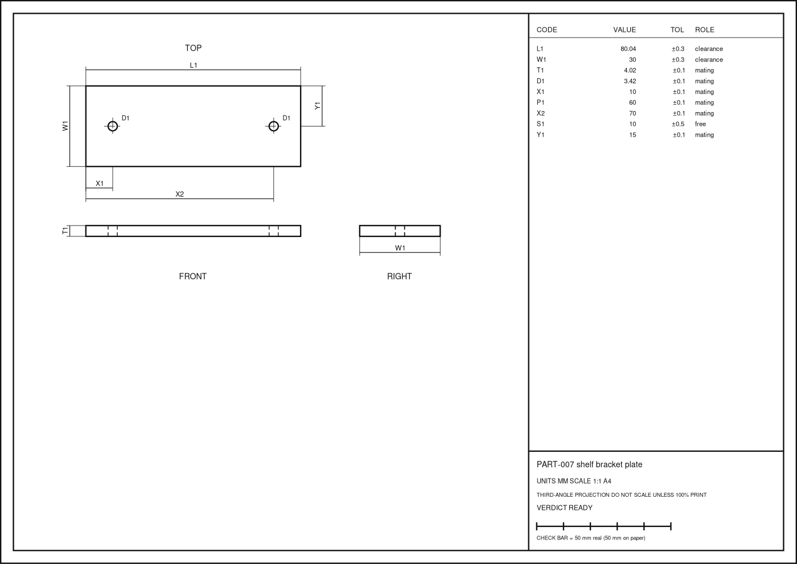

# caliper-sheet

**English** | [中文](README.zh-CN.md)

**Measure a real part once, properly, and get a drawing you can trust.**

caliper-sheet is an agent skill for Claude Code, Codex, Cursor and other agents that read `SKILL.md` files. It walks you from a physical object on your desk (a broken clip, a shelf bracket, a knob, a spacer) to a checked measurement log and a one-page, true-scale drawing that a 3D printer, a workshop or a seller can work from.



## Why

Remaking a part usually fails for small reasons: a single caliper reading taken at an angle, a ruler used where a tenth of a millimetre matters, positions measured edge to edge until the errors pile up, an inch part rounded into millimetres, or a hidden size that someone guessed. caliper-sheet catches each of these before material is cut, and ends with a paper test: print the sheet at 100 %, lay the part on it, and see.

## Features

- **Part card and datums.** Starts from what the part attaches to and which faces matter, then measures positions from reference faces instead of chaining them.
- **Coded sizes with roles.** Every size gets a code (`L1`, `X2`, `D1` …) and a role: `mating` ±0.1 mm, `clearance` ±0.3 mm, `free` ±0.5 mm. Roles drive every check.
- **Three readings per size.** The helper takes the median and flags `REMEASURE` when the readings disagree, `TOOL_TOO_COARSE` when a ruler is used on a precise size, and `FEW_READINGS` for under-measured mating sizes.
- **Formulas for derived sizes.** `X2 = X1 + P1`, `Y1 = W1 / 2`, evaluated safely and in dependency order, with loops and unknown codes refused.
- **Chain closure.** Chains of sizes are summed and compared with the overall size: `CLOSES`, `LOOSE` or `CLOSURE_FAIL`.
- **Honest hints.** Possible imperial sizes (12.70 is 1/2 in) and standard metric clearance holes and tap drills are suggested, never applied.
- **Unknowns stay unknown.** `[TBD]` sizes are carried through formulas and the verdict, never filled in.
- **One verdict.** `READY`, `DRAFT_ONLY` or `MEASURE_AGAIN` (exit code 2), so an agent or a script can stop before drawing.
- **True-scale SVG sheet.** Top, front and right views in third-angle projection, coded dimension lines, a value table, a title block and a 50 mm check bar. 1:1 when it fits, scaled down for big parts, enlarged for tiny ones.
- **Paper proof.** A printed check that the drawing matches the real object.
- **No dependencies.** One Python 3 file, standard library only, with 54 tests.

## Installation

**Claude Code**

```bash
git clone https://github.com/fangdididi/caliper-sheet ~/.claude/skills/caliper-sheet
```

**Codex**

```bash
git clone https://github.com/fangdididi/caliper-sheet ~/.codex/skills/caliper-sheet
```

**Cursor and other agents.** Clone the repo into your project (for example `.cursor/skills/caliper-sheet` or `skills/caliper-sheet`) and point your agent at `SKILL.md` (English) or `SKILL.zh-CN.md` (Chinese).

**claude.ai / Claude desktop.** Zip the folder and upload it as a skill in the app's skill settings.

The helper needs Python 3.8 or newer and nothing else.

## Usage

Ask your agent something like:

> I broke the plastic bracket that holds my shelf. I have a caliper. Help me measure it so I can 3D print a new one.

> What size is this hole, and is this old part in inches?

The agent will ask a few questions, help you set datums, record three readings per size in `part.json`, then run:

```bash
python3 scripts/partsheet.py check part.json        # flags, chains, verdict
python3 scripts/partsheet.py svg part.json -o sheet.svg
python3 scripts/partsheet.py table part.json        # markdown dimension table
```

### A minimal `part.json`

```json
{
  "part": {"id": "PART-001", "name": "spacer", "units": "mm", "purpose": "print"},
  "dims": [
    {"code": "L1", "name": "length", "role": "clearance", "readings": [40.02, 40.00, 40.04]},
    {"code": "W1", "name": "width", "role": "clearance", "readings": [12.00, 12.02, 11.98]},
    {"code": "T1", "name": "thickness", "role": "mating", "readings": [5.00, 5.02, 5.00]},
    {"code": "D1", "name": "bolt hole", "role": "mating", "readings": [4.50, 4.52, 4.48]},
    {"code": "X1", "name": "hole from datum A", "role": "mating", "formula": "L1 / 2"},
    {"code": "Y1", "name": "hole from datum B", "role": "mating", "formula": "W1 / 2"}
  ],
  "body": {"L": "L1", "W": "W1", "T": "T1"},
  "features": [{"kind": "hole", "d": "D1", "x": "X1", "y": "Y1", "through": true}]
}
```

## Examples

- `examples/shelf-bracket.json`: a two-hole plate. Verdict `READY`, the length chain closes within 0.04 mm, and the hole matches an M3 normal-fit clearance hole. The sheet is in `examples/shelf-bracket.svg`.
- `examples/knob-insert.json`: a worn knob insert. Verdict `MEASURE_AGAIN`: the bore readings spread by 0.33 mm, a mating flat is still unknown, and the outer sizes land exactly on 3/4 in and 1/2 in.

Sample check output:

```text
D1         3.42  ±0.1  mating    measured screw hole
      ~ LOOKS_LIKE: M3 clearance (normal)
chain length along hole row: CLOSES  sum 80 vs L1 80.04, off by -0.04 (rss 0.6, worst 1)
VERDICT READY
```

## File structure

```text
caliper-sheet/
├── SKILL.md                 skill instructions (English)
├── SKILL.zh-CN.md           skill instructions (Chinese)
├── README.md                this file
├── README.zh-CN.md          Chinese README
├── LICENSE                  MIT
├── scripts/
│   └── partsheet.py         check, table and svg commands
├── examples/
│   ├── shelf-bracket.json   READY example
│   ├── shelf-bracket.svg    its true-scale sheet
│   ├── shelf-bracket.png    preview image
│   └── knob-insert.json     MEASURE_AGAIN example
└── tests/
    └── test_partsheet.py    54 tests (python3 -m unittest discover -s tests)
```

## License

MIT © fangdididi
